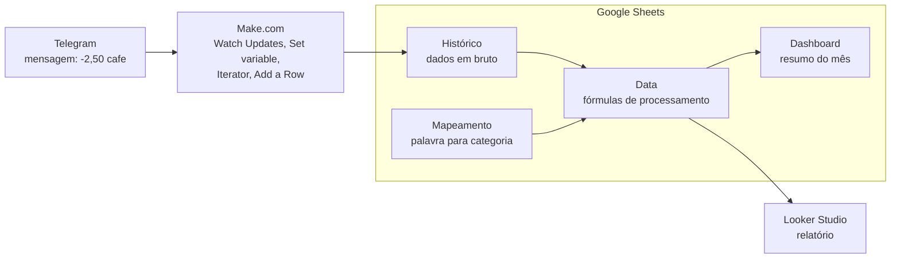
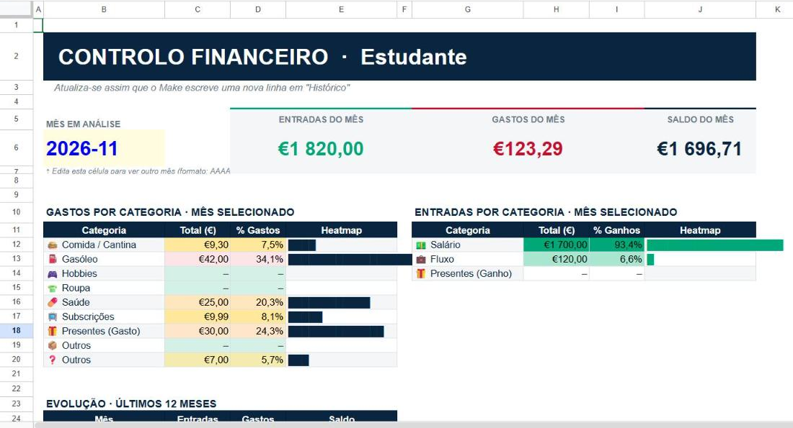
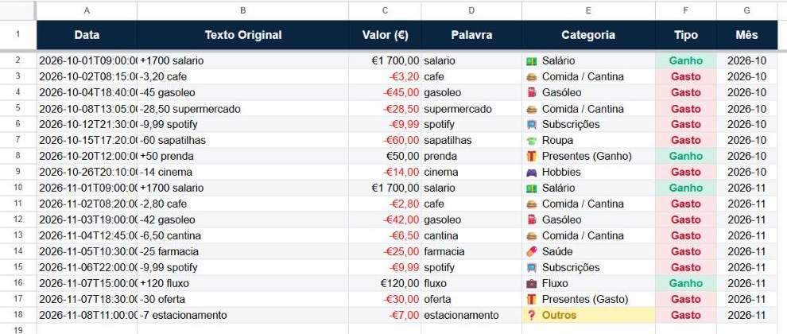
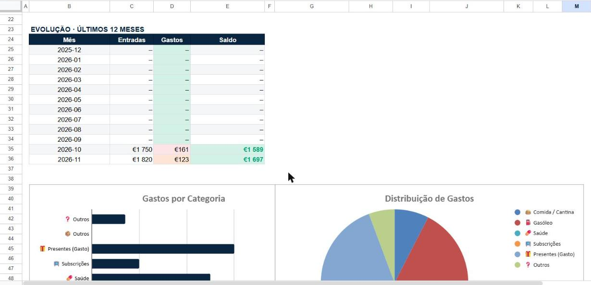

# Registo de despesas com Telegram, Make e Google Sheets

Um sistema pessoal para registar despesas e ganhos com uma mensagem no Telegram. Escrevo `-2,50 cafe` ao bot e, segundos depois, a transação está numa folha do Google Sheets, classificada por categoria e somada no dashboard do mês. É um projeto pessoal, em uso no dia a dia, feito só com ferramentas no-code e fórmulas.

## Como funciona



1. **Telegram**: envio uma mensagem ao bot, com uma transação por linha.
2. **Make.com**: um cenário de 4 módulos recebe a mensagem, divide-a em linhas e escreve cada linha no separador Histórico, sem a alterar.
3. **Google Sheets**: o separador Data calcula, com fórmulas, o valor, a palavra, a categoria, o tipo e o mês. O Mapeamento diz a que categoria pertence cada palavra. O Dashboard resume o mês.
4. **Looker Studio**: um relatório visual ligado à tab Data, que também uso no telemóvel.




## Exemplo

A mensagem

```
-2,50 cafe
```

dá esta linha na tab Data:

| Data | Texto Original | Valor (€) | Palavra | Categoria | Tipo | Mês |
|---|---|---:|---|---|---|---|
| 2026-11-08T09:15:00.000Z | `-2,50 cafe` | -2,50 | cafe | 🍔 Comida / Cantina | Gasto | 2026-11 |

Regras das mensagens: `+` é ganho; `-` (ou sem sinal) é gasto; aceita vírgula ou ponto decimal; várias linhas numa mensagem dão vários registos; maiúsculas e acentos na palavra são ignorados. Mais exemplos em [exemplos/mensagens.md](exemplos/mensagens.md).





Todas as capturas usam dados fictícios.

## Tecnologias

- **Telegram Bot API** (bot criado com o BotFather): a interface de entrada.
- **Make.com**: a automação que liga o Telegram ao Google Sheets.
- **Google Sheets**: armazenamento e processamento, com `ARRAYFORMULA` e expressões regulares (`REGEXEXTRACT`, `REGEXREPLACE`, `REGEXMATCH`).
- **Looker Studio**: relatório e visualização.

## Estrutura do repositório

| Caminho | Conteúdo |
|---|---|
| [docs/montagem.md](docs/montagem.md) | Guia passo a passo para montar o sistema do zero |
| [docs/formulas.md](docs/formulas.md) | Cada fórmula explicada parte a parte, em versão PT e internacional |
| [docs/problemas-e-solucoes.md](docs/problemas-e-solucoes.md) | Os problemas que encontrei e como os resolvi |
| [make/blueprint.json](make/blueprint.json) | O cenário do Make, sem ligações nem identificadores |
| [sheets/modelo.xlsx](sheets/modelo.xlsx) | Modelo da folha com os 5 separadores, o Mapeamento completo e dados fictícios |
| [exemplos/mensagens.md](exemplos/mensagens.md) | Exemplos de mensagens e o resultado na tab Data |
| [imagens/](imagens/) | Capturas de ecrã com dados fictícios |

Para montar o teu: segue o [guia de montagem](docs/montagem.md). Em resumo: crias o bot, importas o modelo para o Google Sheets e colas as fórmulas da tab Data, importas o blueprint no Make (Create a new scenario > **...** > **Import Blueprint**) e crias as tuas próprias ligações ao Telegram e ao Google.

## O que aprendi

- **Integração entre ferramentas.** Cada ferramenta faz bem uma coisa: o Telegram recebe, o Make transporta, o Sheets processa, o Looker Studio mostra. A maior parte do trabalho esteve nas fronteiras entre elas: que formato sai de uma e como a outra o interpreta.
- **Localidade e formatos de dados.** O mesmo texto (`2.20`, `+1800`) pode ser um número, uma data ou uma fórmula, conforme a localidade e as opções de importação. Aprendi a não depender dessas interpretações automáticas e a converter os dados de forma explícita.
- **Separar dados em bruto do processamento.** O Histórico guarda as mensagens exatamente como chegaram; a tab Data transforma-as. Assim posso corrigir uma fórmula ou acrescentar uma palavra ao Mapeamento e todo o histórico é recalculado, sem perder nada.

## Problemas e soluções

Resumo dos problemas mais relevantes. O sintoma, a causa e a solução de cada um estão em [docs/problemas-e-solucoes.md](docs/problemas-e-solucoes.md).

| # | Sintoma | Causa | Solução |
|---|---|---|---|
| 1 | `2,20` aparecia como um número enorme | Em localidade PT, `2.20` era lido como uma data | Extrair parte inteira e decimal em separado |
| 2 | As fórmulas desapareciam ao importar o .xlsx | Funções só do Sheets são descartadas na conversão | Colar essas fórmulas diretamente no Sheets |
| 3 | O Make dava "Unable to parse range" | Nome do ficheiro no campo do nome do separador | Pôr `Histórico` em Sheet Name |
| 4 | Entradas com `+` davam `#ERROR!` | "User entered" lia `+1800` como fórmula | Value input option = Raw |
| 5 | Mensagens com várias linhas ficavam num só registo | `newline` escrito como texto, não como palavra-chave | Inserir a palavra-chave do Make |
| 6 | `-40 presente` caía em Presentes (Ganho) | A categoria dependia só da palavra | Escolher a variante pelo sinal do valor |

## Limitações e trabalho futuro

- A coluna A guarda a hora em que o Make processou a mensagem, não a hora do envio. O texto ISO vem com `Z` (UTC), por isso uma mensagem enviada perto da meia-noite do último dia do mês pode contar para o mês seguinte.
- Não há validação de mensagens mal formatadas: uma linha sem número entra com valor 0 e não conta nos totais.
- A normalização da palavra não trata maiúsculas acentuadas: `CAFÉ` fica `café` e cai em ❓ Outros. A correção está descrita em [formulas.md](docs/formulas.md#d2-palavra).
- Planeado, ainda não implementado: um comando `/resumo` no bot (um Router no Make com um ramo que lê o resumo da folha e responde) e um resumo automático semanal.
- Possível evolução: refazer o dashboard em Power BI.

---

## Summary (English)

A personal expense tracker driven by Telegram messages. I send `-2,50 cafe` to a Telegram bot; a four-module Make.com scenario splits the message into lines and appends each one, unchanged, to a Google Sheets tab. Array formulas then extract the amount, normalise the keyword, look up its category in a mapping table and feed a monthly dashboard and a Looker Studio report. The repository includes a step-by-step setup guide, every formula explained (Portuguese and English locale versions), the cleaned Make blueprint, a template spreadsheet with fictitious data, and a write-up of the problems I hit, most of them caused by locale and data format differences between tools. Documentation is in Portuguese.
