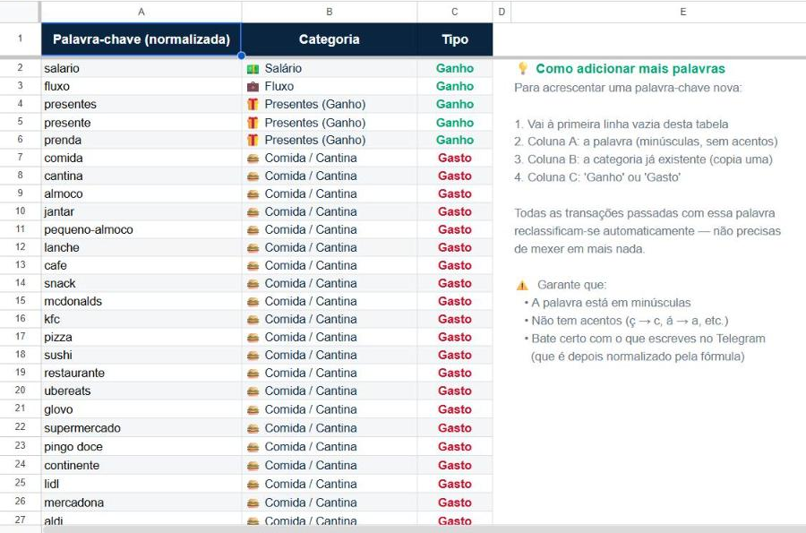
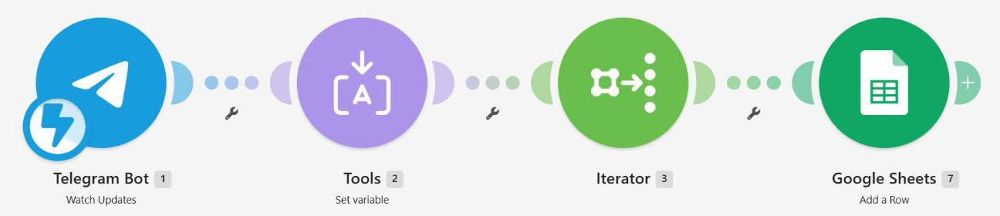

# Guia de montagem

Este guia monta o sistema do zero. Precisas de uma conta Telegram, uma conta Google e uma conta gratuita no [Make.com](https://www.make.com). Demora cerca de 30 minutos.

A ordem é: **1. Bot do Telegram → 2. Google Sheets → 3. Make → 4. Looker Studio (opcional)**.

> **Segurança:** o token do bot dá controlo total sobre ele. Nunca o publiques (nem em capturas de ecrã). Se o expuseres por engano, gera um novo no BotFather com `/revoke`.

## 1. Criar o bot do Telegram

1. No Telegram, abre uma conversa com **@BotFather** (o bot oficial para criar bots; tem o visto azul).
2. Envia `/newbot`.
3. Escolhe um **nome** (o que aparece na conversa, por exemplo `Os Meus Gastos`).
4. Escolhe um **username**, que tem de ser único e terminar em `bot` (por exemplo `meus_gastos_123_bot`).
5. O BotFather responde com o **token**, no formato `<NUMERO>:<TEXTO_LONGO>`. Guarda-o num sítio seguro: vais precisar dele no Make.
6. Abre a conversa com o teu bot novo (há um link na resposta do BotFather) e carrega em **Start**.

O bot não precisa de código. Quem lê as mensagens é o Make.

## 2. Preparar o Google Sheets

### 2.1 Criar a folha a partir do modelo

1. Descarrega [`sheets/modelo.xlsx`](../sheets/modelo.xlsx).
2. No [Google Sheets](https://sheets.google.com), cria uma folha em branco.
3. **Ficheiro > Importar > Carregar** e escolhe o `modelo.xlsx`. Em "Localização da importação", escolhe **Substituir folha de cálculo**.
4. **Ficheiro > Definições > Localização**: escolhe **Portugal** se quiseres usar as fórmulas PT tal como estão em [formulas.md](formulas.md). Com outra localidade, usa as versões internacionais. Confirma esta definição depois da importação.

Ficas com cinco separadores:

| Separador | Para que serve |
|---|---|
| **Histórico** | Dados em bruto. Só o Make escreve aqui: A = data/hora, B = texto original da linha. |
| **Data** | Processamento. Uma fórmula por coluna, na linha 2. Não se escreve nada à mão. |
| **Mapeamento** | Palavra-chave normalizada → categoria → tipo. |
| **Dashboard** | Resumo do mês e evolução de 12 meses. |
| **Como Usar** | Instruções curtas. |

### 2.2 Colar as fórmulas da tab Data

As fórmulas da tab Data usam funções que só existem no Google Sheets, por isso não vêm no .xlsx (ver o [problema 2](problemas-e-solucoes.md#2-as-fórmulas-desapareciam-ao-importar-o-modelo-xlsx)).

1. Abre o separador **Data** e apaga o texto de aviso em A2.
2. Copia de [formulas.md](formulas.md) as fórmulas de **A2, B2, C2, D2, E2, F2 e G2** (versão PT ou internacional, conforme a localidade) e cola cada uma na sua célula da linha 2.
3. As 17 transações de exemplo do Histórico devem aparecer processadas. Compara com a tabela em [exemplos/mensagens.md](../exemplos/mensagens.md).
4. No **Dashboard**, escreve `'2026-10` em B6 para ver o mês de exemplo. A plica no início obriga o Sheets a guardar o valor como texto e não como data. Depois volta a pôr a fórmula `=TEXTO(HOJE();"YYYY-MM")` (ou `=TEXT(TODAY(),"YYYY-MM")`).

### 2.3 Limpar os exemplos

Quando tudo estiver a funcionar, apaga as linhas 2 em diante do **Histórico** (mantém o cabeçalho na linha 1). Não apagues nada na tab Data: ela esvazia-se sozinha.

### 2.4 Personalizar o Mapeamento

- A coluna A tem a palavra **já normalizada**: minúsculas e sem acentos (`gasoleo`, não `Gasóleo`).
- A coluna B tem a categoria, exatamente como queres que apareça.
- Para categorias que podem ser ganho ou gasto (como presentes), usa o sufixo `(Ganho)` ou `(Gasto)`: a fórmula E2 troca-o pelo sinal do valor.
- Se criares uma categoria nova de gasto, acrescenta-a também em B12:B20 do Dashboard (ou alarga o intervalo). As de ganho ficam em G12:G14.

Quando acrescentas uma palavra, todo o histórico é reclassificado.



## 3. Configurar o cenário no Make

### 3.1 Importar o blueprint

1. No Make, abre **Scenarios > Create a new scenario**.
2. No menu **...** (mais opções), escolhe **Import Blueprint** e carrega [`make/blueprint.json`](../make/blueprint.json).

Ficas com quatro módulos ligados:

```
Telegram Bot: Watch Updates → Tools: Set variable → Iterator → Google Sheets: Add a Row
```



O blueprint não traz ligações nem identificadores (estão substituídos por marcadores como `<SPREADSHEET_ID>`). Tens de criar as tuas ligações e escolher a tua folha.

### 3.2 Ligar o Telegram (módulo 1)

1. Abre o módulo **Telegram Bot: Watch Updates**.
2. Em **Webhook**, carrega em **Add** e depois em **Add** outra vez para criar uma ligação.
3. Cola o **token** do BotFather e guarda.

### 3.3 Confirmar o Set variable e o Iterator (módulos 2 e 3)

- **Set variable**: nome `linhas`, valor `split(1. Message: Text; newline)`. O `newline` tem de aparecer como um bloco colorido (a palavra-chave do Make). Se aparecer como texto simples, apaga-o e insere-o a partir do painel de funções de texto. Ver o [problema 5](problemas-e-solucoes.md#5-mensagens-com-várias-linhas-ficavam-num-só-registo).
- **Iterator**: Array = `2. linhas`. Divide a mensagem e entrega uma linha de cada vez ao módulo seguinte.

### 3.4 Ligar o Google Sheets (módulo 4)

1. Abre **Google Sheets: Add a Row** e cria uma ligação à tua conta Google.
2. **Spreadsheet**: escolhe a tua folha.
3. **Sheet Name**: `Histórico` (o nome do separador, não do ficheiro; ver o [problema 3](problemas-e-solucoes.md#3-o-make-dava-unable-to-parse-range)).
4. **Table contains headers**: Yes.
5. Colunas: **A** = `now`; **B** = `3. Value` (a linha atual do Iterator). As outras ficam vazias.
6. **Value input option**: **Raw**. Isto é obrigatório: com "User entered", as mensagens que começam por `+` dão `#ERROR!` (ver o [problema 4](problemas-e-solucoes.md#4-entradas-com--apareciam-como-error)).
7. **Insert data option**: Insert rows.

### 3.5 Ativar

1. Em baixo à esquerda, no agendamento, escolhe **Immediately as data arrives**.
2. Guarda o cenário e liga-o (interruptor **ON**).
3. Envia ao bot `-2,50 cafe`. Em poucos segundos deve aparecer uma linha nova no Histórico e na tab Data.

**Custo:** cerca de 4 créditos do Make por mensagem de uma linha (cada linha a mais soma o módulo Add a Row outra vez). O plano gratuito tem 1000 créditos por mês.

## 4. Relatório no Looker Studio (opcional)

O Dashboard da folha já chega para o dia a dia. O Looker Studio dá um relatório mais visual, que também funciona bem no telemóvel.

1. Em [lookerstudio.google.com](https://lookerstudio.google.com), cria um **Relatório** novo.
2. Adiciona dados com o conector **Google Sheets**: escolhe a tua folha, o separador **Data** e deixa marcada a opção de usar a primeira linha como cabeçalhos.
3. Na origem de dados, confirma os tipos: **Valor (€)** como número (ou moeda em EUR) e **Data** como data/hora (muda o tipo se vier como texto).
4. Cria dois campos calculados (**Adicionar um campo**):
   - `Gastos` = `CASE WHEN Valor (€) < 0 THEN -Valor (€) ELSE 0 END`
   - `Entradas` = `CASE WHEN Valor (€) > 0 THEN Valor (€) ELSE 0 END`
5. Monta os gráficos:
   - **Cartões de resumo**: Entradas, Gastos e Saldo (soma de `Valor (€)`).
   - **Donut**: dimensão `Categoria`, métrica `Gastos`.
   - **Barras**: dimensão `Mês`, métricas `Entradas` e `Gastos` no mesmo eixo.
   - **Tabela**: as transações (Data, Texto Original, Valor (€), Categoria).
   - **Controlos**: intervalo de datas, lista pendente de `Mês` e de `Categoria`.

**No telemóvel:** abre o link do relatório no browser e usa a opção **Adicionar ao ecrã principal**. Fica como se fosse uma app.

## Problemas?

Os erros mais comuns (e as soluções) estão em [problemas-e-solucoes.md](problemas-e-solucoes.md).
