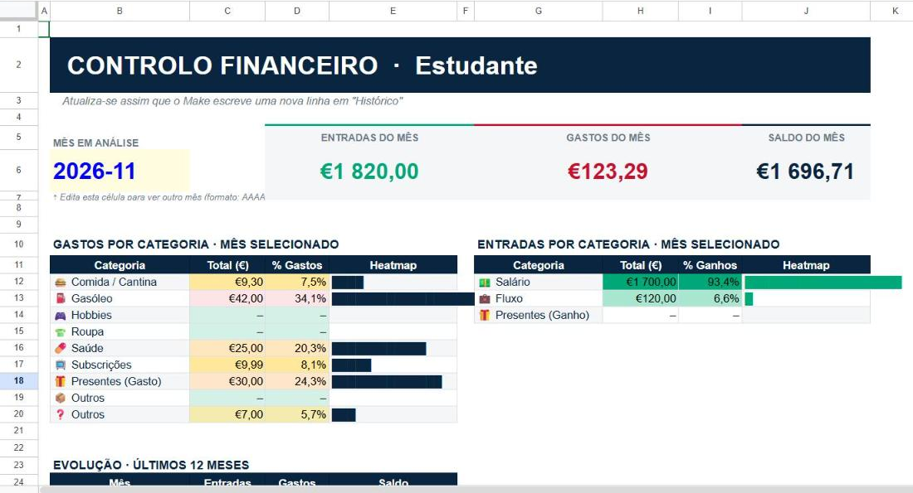

# Exemplos de mensagens

Todos os valores aqui são **fictícios**. São os mesmos dados que vêm no [modelo](../sheets/modelo.xlsx).

## Formato

Uma transação por linha: `<sinal><valor> <palavra>`

| Mensagem | Significado |
|---|---|
| `-2,50 cafe` | Gasto de 2,50 € em café |
| `+1700 salario` | Ganho de 1700 € |
| `2.20 cafe` | Sem sinal conta como gasto; o ponto também serve de separador decimal |
| `-28,50 Supermercado` | Maiúsculas no início são ignoradas |
| `-25 farmácia` | Acentos são ignorados (dá `farmacia`) |
| `-12 pingo doce` | A palavra pode ter espaços |

## Várias transações numa só mensagem

Cada linha da mensagem vira um registo separado no Histórico:

```
-30 oferta
-7 estacionamento
```

Dá duas linhas no Histórico, uma por transação.

## Do Histórico à tab Data

O Make escreve só as colunas A e B do **Histórico**. Tudo o resto é calculado pelas fórmulas da tab **Data** (explicadas em [formulas.md](../docs/formulas.md)):

| A Data | B Texto Original | C Valor (€) | D Palavra | E Categoria | F Tipo | G Mês |
|---|---|---:|---|---|---|---|
| 2026-10-01T09:00:00.000Z | `+1700 salario` | 1700,00 | salario | 💵 Salário | Ganho | 2026-10 |
| 2026-10-02T08:15:00.000Z | `-3,20 cafe` | -3,20 | cafe | 🍔 Comida / Cantina | Gasto | 2026-10 |
| 2026-10-04T18:40:00.000Z | `-45 gasoleo` | -45,00 | gasoleo | ⛽ Gasóleo | Gasto | 2026-10 |
| 2026-10-08T13:05:00.000Z | `-28,50 supermercado` | -28,50 | supermercado | 🍔 Comida / Cantina | Gasto | 2026-10 |
| 2026-10-12T21:30:00.000Z | `-9,99 spotify` | -9,99 | spotify | 📺 Subscrições | Gasto | 2026-10 |
| 2026-10-15T17:20:00.000Z | `-60 sapatilhas` | -60,00 | sapatilhas | 👕 Roupa | Gasto | 2026-10 |
| 2026-10-20T12:00:00.000Z | `+50 prenda` | 50,00 | prenda | 🎁 Presentes (Ganho) | Ganho | 2026-10 |
| 2026-10-26T20:10:00.000Z | `-14 cinema` | -14,00 | cinema | 🎮 Hobbies | Gasto | 2026-10 |
| 2026-11-01T09:00:00.000Z | `+1700 salario` | 1700,00 | salario | 💵 Salário | Ganho | 2026-11 |
| 2026-11-02T08:20:00.000Z | `-2,80 cafe` | -2,80 | cafe | 🍔 Comida / Cantina | Gasto | 2026-11 |
| 2026-11-03T19:00:00.000Z | `-42 gasoleo` | -42,00 | gasoleo | ⛽ Gasóleo | Gasto | 2026-11 |
| 2026-11-04T12:45:00.000Z | `-6,50 cantina` | -6,50 | cantina | 🍔 Comida / Cantina | Gasto | 2026-11 |
| 2026-11-05T10:30:00.000Z | `-25 farmacia` | -25,00 | farmacia | 💊 Saúde | Gasto | 2026-11 |
| 2026-11-06T22:00:00.000Z | `-9,99 spotify` | -9,99 | spotify | 📺 Subscrições | Gasto | 2026-11 |
| 2026-11-07T15:00:00.000Z | `+120 fluxo` | 120,00 | fluxo | 💼 Fluxo | Ganho | 2026-11 |
| 2026-11-07T18:30:00.000Z | `-30 oferta` | -30,00 | oferta | 🎁 Presentes (Gasto) | Gasto | 2026-11 |
| 2026-11-08T11:00:00.000Z | `-7 estacionamento` | -7,00 | estacionamento | ❓ Outros | Gasto | 2026-11 |

Repara em três casos:

- **`+50 prenda`** e **`-30 oferta`**: a categoria de presentes muda entre `(Ganho)` e `(Gasto)` conforme o sinal (ver o [problema 6](../docs/problemas-e-solucoes.md#6--40-presente-era-classificado-como-presentes-ganho)).
- **`-7 estacionamento`**: a palavra não está no Mapeamento e por isso cai em `❓ Outros`. Basta acrescentar uma linha `estacionamento` no Mapeamento para o registo ser reclassificado.
- **Coluna A**: é a hora em que o Make processou a mensagem, em formato ISO. A coluna G extrai daí o mês.

## Resultado no Dashboard



| Mês | Entradas | Gastos | Saldo |
|---|---:|---:|---:|
| 2026-10 | 1750,00 € | 160,69 € | 1589,31 € |
| 2026-11 | 1820,00 € | 123,29 € | 1696,71 € |

## Mensagens mal formatadas

| Mensagem | O que acontece |
|---|---|
| `cafe` (sem número) | Valor 0, sem tipo; não entra nos totais |
| `-3 CAFÉ` | Fica `café` (a maiúscula acentuada não é normalizada) e cai em `❓ Outros`; ver as limitações no [README](../README.md#limitações-e-trabalho-futuro) |
